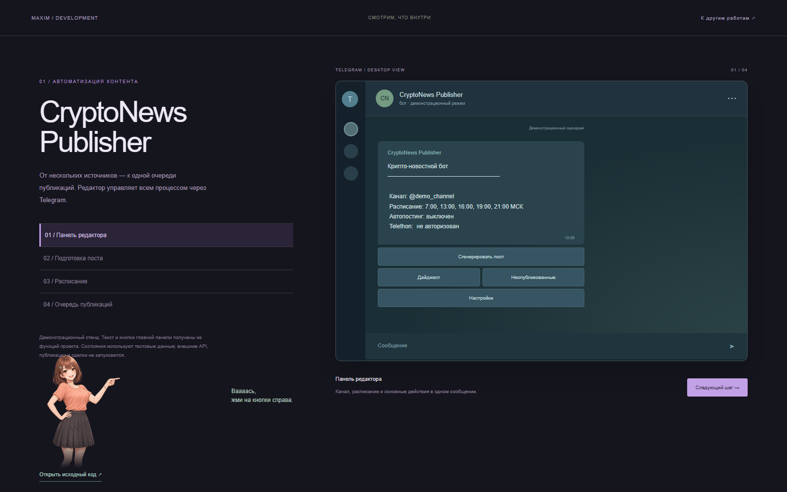
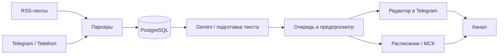

# CryptoNews Publisher

Telegram-бот для редактора криптовалютного новостного канала: собирает материалы из RSS и Telegram, готовит публикации через Gemini и даёт управлять очередью и расписанием из одного интерфейса.



[Интерактивная демонстрация](https://max0209-web.github.io/developer-portfolio/demo.html?project=crypto) · [Портфолио разработчика](https://max0209-web.github.io/developer-portfolio/)

Изображение показывает демонстрационный стенд: главная панель получена из функций бота, внешние сервисы не подключены. Это не запись действующего Telegram-канала.

## Задача и сценарий

Редактору не нужно вручную обходить все источники и переносить каждый материал в канал. Бот объединяет сбор, подготовку текста, предпросмотр и публикацию. Автоматическую публикацию можно отключить; тогда материал передаётся администраторам на проверку.

1. RSS-парсер обходит семь настроенных лент. Telethon читает список каналов из `config.py`, если настроена пользовательская сессия.
2. Материалы сохраняются в PostgreSQL с идентификатором источника и ссылкой.
3. Gemini получает подборку и предыдущие заголовки, возвращает JSON с текстом и метаданными.
4. Редактор открывает предпросмотр: публикует, отклоняет, перегенерирует или выбирает публикацию без фото.
5. Планировщик работает по московскому времени. Режим автопубликации управляется в настройках бота.

## Реализованные возможности

- Сбор RSS и Telegram-каналов, фильтрация свежести RSS за последние 24 часа.
- Подготовка поста и дайджеста, обратная связь редактора для следующих генераций.
- Проверка похожих заголовков по общим ключевым словам; это эвристика, не семантическая гарантия уникальности.
- Очередь неопубликованных материалов, статусы публикаций и история в БД.
- Предпросмотр текста и медиа, резервный путь публикации через Bot API.
- Настройка канала, часов публикации и авторизации Telethon.
- Работа с изображениями источников и опциональный подбор через Unsplash.
- Конвертация видео в 9:16 через FFmpeg с возвратом исходного файла при ошибке.
- Уведомление администраторам при длительном отсутствии публикаций.

## Архитектура



| Модуль | Ответственность |
| --- | --- |
| `bot.py` | Команды, callback-кнопки, предпросмотр, публикация и фоновые задачи |
| `rss_parser.py` | Параллельное чтение лент, извлечение текста и медиа |
| `parser.py` | Чтение Telegram-источников |
| `ai.py` | Запросы Gemini, разбор JSON, подготовка текста |
| `database.py` | Новости, публикации, настройки и обратная связь |
| `telethon_client.py` | Сессии и выбор аккаунта для публикации |
| `images.py` | Загрузка медиа и FFmpeg |

## Запуск

Рекомендуется Python 3.12, PostgreSQL 16. FFmpeg нужен для преобразования видео.

```bash
cp .env.example .env
# Заполните значения в .env
docker compose up -d --build
```

Обязательно задать `BOT_TOKEN`, `ADMIN_IDS`, `GEMINI_API_KEY`, `POSTGRES_PASSWORD`. `CHANNEL_ID` можно задать сразу или через интерфейс. Пароль PostgreSQL должен быть пригоден для URL либо закодирован для URL. Для локального запуска без Docker заполните `DATABASE_URL`.

```bash
python -m venv .venv
# Windows: .venv\Scripts\activate
# Linux/macOS: source .venv/bin/activate
pip install -r requirements.txt
python bot.py
```

Для чтения каналов через Telethon нужны собственные `API_ID`, `API_HASH` и `SESSION_STRING`. Сессию можно создать `python gen_session.py` или через настройки бота. Созданную сессию храните как пароль. Bot API требует права публикации в целевом канале.

## Проверка

```bash
pip install pytest
python -m pytest tests -q
python -m compileall -q .
```

Тесты проверяют стабильные RSS-ID, контроль доступа callback-кнопок, преобразование текста, ограничение длины и проверку заголовков. Они не отправляют сообщения и не вызывают Gemini. Проверка боевого канала, доставки и доступности внешних API выполняется отдельно с настроенным окружением.

## Ограничения текущей версии

- Это один процесс бота; распределённый планировщик не реализован.
- Запоминание слота планировщика находится в памяти: рестарт в том же временном окне может повторить обработку. Для строгой однократности нужен уникальный слот в БД.
- Часть медиа кэшируется в памяти и временной директории; восстановление всех медиа после рестарта не гарантировано.
- Сессии администраторов хранятся в настройках БД без отдельного шифрования на уровне приложения.
- Генерация требует редакторской проверки фактов. Источники и права на медиа определяются владельцем канала.

## Публичная версия

Из исходного архива исключены персональные настройки IDE, кэши и посторонние скрипты администрирования серверов. Ключи удалены из исходников; пример окружения содержит только пустые поля и учебный пароль. Интерфейс публичной версии оформлен без эмодзи. Коммиты оформлены от имени владельца репозитория без дополнительных соавторов.
